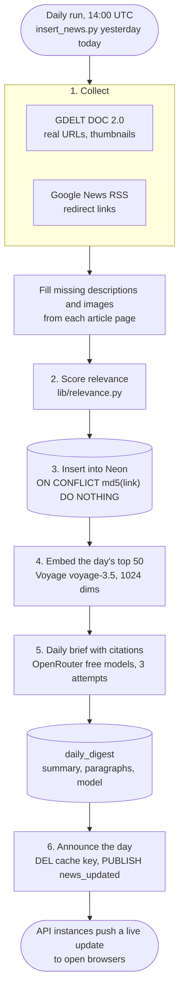

<div align="center">

# News pipeline for Trump of the Day

**The batch job behind [trumpoftheday.com](https://trumpoftheday.com).** Once a day it scrapes the news, ranks it, has a free LLM write a cited brief, embeds each day's top stories for semantic search, and tells the live site to refresh.


</div>

> **This repository is a data pipeline, not a server.** Despite the `-server` in its name, nothing here listens for requests. It's a batch job: GitHub Actions runs it once a day, it writes stories, a brief and embeddings to Postgres, and it exits. The web server the site talks to is the Fastify API in [`api/`](https://github.com/divij-pawar/trump-of-the-day/tree/main/api) of the main repository. The repository is due to be renamed to reflect this; until then, links and badges still use `trump-of-the-day-server`.

| Lives here (pipeline) | Lives in the [main repo](https://github.com/divij-pawar/trump-of-the-day) |
|---|---|
| Scraping, dedupe, relevance scoring | React website (`src/`) |
| Daily brief and embeddings | Fastify API that serves the data (`api/`) |
| Database schema and migrations (`db/`) | Terraform for GCP and AWS (`infra/`) |
| Daily GitHub Actions job and its Docker image | Website and API deploys |

## What a run does



Every step after the insert is optional and isolated. If there's no Voyage key, embeddings are skipped. If the brief fails, the day keeps its ranked stories and the next run, which re-processes yesterday, tries again. The announcement never stops a run.

## Technical highlights

- **Two sources, one result.** GDELT supplies real article URLs and thumbnails; Google News RSS adds breadth. Results are merged and deduplicated. The scraper obeys GDELT's rate limit with a 6-second minimum between its own requests, and everything is plain HTTP with retry and backoff: no headless browser.
- **Idempotent by design.** A unique index on `md5(link)` makes inserts skip duplicates. It's a hash because some Google redirect links are several kilobytes, over what a btree can index. Every maintenance command only acts on rows that still need it, so anything can be re-run.
- **Ranked, not filtered.** A hard keyword filter would have deleted hundreds of legitimate administration stories, so each article gets a heuristic score instead (headline match, outlet reputation, completeness, minus idioms such as "trump card"). The API orders each day by it, and the brief reads the top 40.
- **A brief you can check.** The model writes the summary sentence by sentence and names the stories each sentence rests on. Citations for stories the model wasn't shown are dropped, and the model that wrote the brief is stored with it.
- **Built for unreliable free models.** Reasoning is capped, structured output is requested, and each run makes up to three attempts, re-routed to a possibly different model.
- **Embeddings where they pay off.** `voyage-3.5` vectors (1024 dimensions) in pgvector with an HNSW index power semantic search and "related coverage" on the site. Only each day's top 50 stories by relevance are embedded: a vector and its index entry take about 12 KB against about 2 KB for the story alone, and the index was the biggest object in the database. `EMBED_TOP_PER_DAY` changes the limit (`0` embeds everything).
- **Safe live updates.** After a day is processed the run deletes that day's cached API response and publishes its date on a Redis channel through Upstash's REST API, so even a scaled-to-zero API serves fresh data on the next visit.
- **Tested without network or database.** 56 pytest cases cover scoring, digest parsing, embeddings batching, the scraper's helpers and the order of the enrichment steps, with external clients faked.

## Quick start

```bash
python -m venv env && source env/bin/activate
pip install -r requirements-dev.txt     # requirements.txt + pytest
python -m pytest                        # no network or database needed
```

To run it against a database, create a `.env` (see [docs/setup.md](docs/setup.md) for every variable) and apply `db/schema.sql`:

```bash
DATABASE_URL=postgres://... python insert_news.py yesterday today
```

The main repository's `docker compose up -d` starts a throwaway Postgres with pgvector and Redis that the pipeline can run against safely.

| Variable | Needed for |
|---|---|
| `DATABASE_URL` | Everything. The **owner** role: the pipeline writes. |
| `OPENROUTER_API_KEY` | The daily brief (free models). |
| `VOYAGE_API_KEY` | Embeddings for search and related coverage. |
| `EMBED_TOP_PER_DAY` | How many of each day's stories get an embedding. Default 50; `0` means all. |
| `UPSTASH_REDIS_REST_URL`, `UPSTASH_REDIS_REST_TOKEN` | Telling the production API a day changed. |
| `ANTHROPIC_API_KEY`, `DIGEST_PROVIDER=anthropic` | Writing the brief with Claude instead. |

Only `DATABASE_URL` is required. A step with no key is skipped, and the raw stories are still saved.

## Commands

```bash
python insert_news.py [start] [end]      # scrape and store a day or a range
python insert_news.py enrich 2026-11-01 2026-11-18
python insert_news.py rescore
python insert_news.py backfill-embeddings
python delete_news.py 2025-09-10 --force
```

Dates are `YYYY-MM-DD`, `today` or `yesterday` (UTC, the same day boundary as the site). Every subcommand, with arguments and example output, is in [docs/cli.md](docs/cli.md).

## Documentation

| Doc | What's in it |
|---|---|
| [docs/setup.md](docs/setup.md) | **Setting everything up:** database, environment, GitHub secrets, the image, the schedule, first production run, troubleshooting |
| [docs/cli.md](docs/cli.md) | Every command with arguments and examples |
| [docs/scripts.md](docs/scripts.md) | Every function in `news_scraper.py`, `insert_news.py`, `delete_news.py`, and the `Dockerfile` |
| [docs/lib.md](docs/lib.md) | `lib/utils.py` (database layer), `relevance.py`, `digest*.py`, `embeddings.py`, `live.py` |
| [docs/db.md](docs/db.md) | The schema, migrations and the Neon read-only-role gotcha |
| [docs/github.md](docs/github.md) | What each workflow and template in `.github/` does |
| [CHANGELOG.md](CHANGELOG.md) | What changed, release by release |

## License

[MIT](LICENSE).
